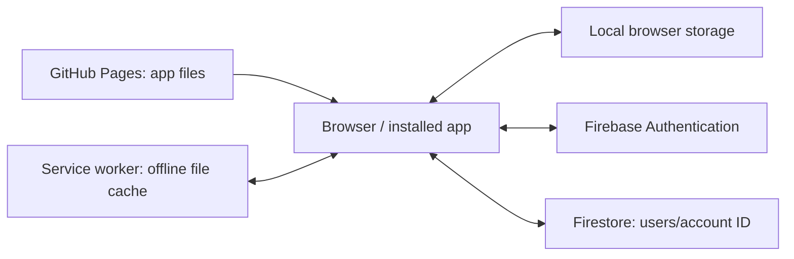

# Bharathi’s Study Tracker — code and user guide

This guide explains the current study app in plain language, with technical details for maintaining it. It describes the implementation rather than promising capabilities beyond the code.

- Repository: https://github.com/Bharathibanu/study-app
- Website: https://bharathibanu.github.io/study-app/
- Firebase project: `studyapp-tracker`
- Platform: static browser app, installable as a Progressive Web App (PWA).

For the new SSC CGL features and revised sync design, see [SSC CGL preparation tools](SSC_CGL_FEATURES.md).

## Contents

1. Architecture and vocabulary
2. Repository files
3. Every screen and feature
4. Plan, achievement and gap calculations
5. JavaScript structure and events
6. Data model
7. Login, Firebase and privacy
8. Offline operation and sync limitations
9. Backups and recovery
10. Installation and updates
11. Design and accessibility
12. Local development and verification
13. Troubleshooting
14. Function and action reference

## 1. Architecture and vocabulary

The browser downloads HTML, CSS and JavaScript from GitHub Pages. JavaScript runs on your device, reads local records, and talks to Firebase when signed in. There is no custom application server, npm build pipeline or Android APK in this repository.



| Term | Meaning here |
|---|---|
| Repository | The folder and history of app source files on GitHub |
| Branch `main` | The version GitHub Pages publishes |
| Commit | A saved set of code changes with a unique ID |
| Deployment | Publishing repository files to the website |
| HTML | Screen structure |
| CSS | Colours, sizes, spacing, responsive layout and animations |
| JavaScript | Behaviour, calculations and saving |
| JSON | Structured text representing your records |
| CSV | Rows of timetable data separated by commas |
| UID | Firebase’s unique account identifier, distinct from your email |
| PWA | A website installed with its own icon and window |
| Service worker | Browser-managed code that caches app files |

## 2. Repository files

### `index.html`: the app shell

Defines the login form, welcome animation, app container, sidebar, page content area, shared modal and toast. Loads the stylesheet and `app.js` as a JavaScript module. Links the manifest, icons and Google Fonts.

Important elements: `#login`, `#lform`, `#user`, `#pass`, `#welcome`, `#app`, `#side`, `#view`, `#modal`, `#mform`, `#toast`. JavaScript finds these by ID and changes their contents or visibility.

`hidden` determines whether a screen is displayed. The CSS `[hidden] { display: none !important; }` rule is necessary because layout rules such as `display:flex` would otherwise override the browser’s hiding behaviour.

### `styles.css`: the design

Defines colour variables, fonts, light/dark mode, forms, cards, charts, tables, modal layout, mobile navigation, print styles and motion. The calm teal-and-gold additions use restrained shadows, gold borders, gradient progress bars and short interaction animations. Reduced-motion rules disable animation and transitions.

Changing a colour variable affects many components. Semantic error colours remain separate from decorative gold.

### `app.js`: the application

Contains the data model, local persistence, Firebase integration calls, date utilities, view rendering, study tracking, revision quizzes, timetable import, expense calculations, reminders and event handlers. Most application behaviour lives here.

### `cloud.js`: the Firebase adapter

Imports public Firebase configuration. Dynamically loads Firebase SDK version `10.12.2` from Google’s CDN only when configuration is enabled. Initializes Authentication and Firestore, attempts persistent Firestore caching, exposes account operations, watches the account document and saves the state as JSON.

### `firebase-config.js`: project identification

Exports `apiKey`, `authDomain`, `projectId` and `appId`. These identify the web application; they are not the user’s password or a service-account credential. Database protection comes from Authentication and Firestore rules. Analytics and Storage are not initialized by this app even if the Firebase console’s example includes their configuration.

### `my-timetable.csv`: your timetable

Contains 542 original topic groups for Days 1–190, extracted from the uploaded PDF. The cover says 200 days, but Days 191–200 are absent. Topic numbers are lesson identifiers, not durations. The CSV retains one-hour placeholder estimates because the PDF provides no durations. The app now assigns the selected 45 or 60 minutes to each individual unfinished/future lesson.

Columns: `Day,Date,Subject,Topic,Planned Hours,Notes`. Blank dates are filled using the chosen Day 1 date. Quoted CSV values preserve commas inside topics. The current importer does not save the Notes column into plan rows.

### `sw.js`: offline files and update cache

Caches the app shell, code, stylesheet, configuration, manifest, timetable and icons. On installation it fills the cache and requests activation. On activation it deletes older named caches and claims clients. For matching GET requests it returns a cached response when available while attempting a network refresh. Authentication and database traffic are not replaced with cached HTML responses.

Increasing the cache version accompanies app-file changes. This updates cached assets; it does not erase localStorage or Firebase records.

### `manifest.json`: installation metadata

Defines the full name, short name, description, launch URL, scope, standalone display, theme/background colours and icon sizes. The maskable icon has padding for Android launcher cropping. Installed-icon refresh timing is controlled partly by the browser and phone.

### `icons/`

Current `logo-192.png`, `logo-512.png` and `logo-maskable-512.png` provide the golden artwork for browser and installed icons. Older icon files may remain in the repository but are not the current manifest references.

### `README.md` and this guide

The README contains the original setup and usage instructions; some wording predates later additions. This guide documents the expanded implementation. Neither file is a database backup.

## 3. Every screen and feature

### Login and account creation

Firebase mode uses name, email and password for registration, then email/password for sign-in. Remember me chooses persistent versus session authentication. Password hashing and verification are handled by Firebase in this mode. A legacy local-only mode exists when Firebase configuration contains placeholders; that mode stores a salted hash in browser storage and does not synchronize accounts.

Creating a Firebase account does not automatically migrate the previous local-only state. Import a backup after signing in if migration is needed.

### Home

Shows the greeting, date, streak, daily task percentage, study minutes, expenses, critical items, today’s schedule, meetings, compact to-dos, level and badges. The Home-only plan-tracking panel shows achievement against imported plan rows. It is not repeated on other sections.

Task checkbox: records the remaining planned minutes as manually completed. **Part** / **Log progress**: records a chosen number of minutes. Delete removes the task and linked study logs. Reschedule moves an unfinished task’s working date; its original due date still matters for overdue accounting.

### Study Timer

Focus and break periods use configured minute lengths. Start/pause controls interval updates. Stop and save opens a session form; elapsed time is not automatically durable just because the timer ran. The form records subject, topic, minutes and focus rating.

Choose a plan topic in the session form to credit its achievement. Extra study remains a session but does not reduce a plan topic’s gap. Credited minutes are capped at the task’s remaining planned duration. Deleting a linked session subtracts its credited minutes and can reopen the task.

### Trendline

Uses study logs to show a recent-hours chart, averages, week-to-week direction, focused-day comparisons and a heatmap. Comparisons use the general daily target. Home separately reports imported-plan achievement. A trend of total study hours is not the same as finishing assigned plan topics.

### Quick Revision

Offers generated short arithmetic drills, learning examples, practice, multiple-choice options and flashcards. Quiz state tracks answers, score and timing. Finished drills enter the quick-revision history; incorrect answers can become mistakes to revisit. These drills do not automatically complete SSC timetable lessons. New Topic Practice, Mistake Notebook, Revision Queue, CGL Mock Analysis and PYQ Bank pages are described in the linked SSC guide.

### Revision Log

Records topic, subject, date, minutes, question count and correct answers. Due revisions use offsets of 1, 3, 7, 15 and 30 days from the first matching study date, advancing based on logged revisions. Weak topics are below 60% accuracy over at least 10 questions. This is a simple schedule based on counts, not an adaptive memory model.

### Reports

Day reports show timetable rows, planned time, achieved task minutes, statuses and carry-forward work. Week/month reports summarize study logs, tasks and expenditure. Printing uses browser print styles and can save a PDF. Cumulative achievement against the imported plan is shown only on Home; Reports retains its own selected-period calculations.

### SSC Plan

Load the supplied timetable, upload CSV or paste CSV text. Choose Day 1 when dates are absent. Skip-past mode excludes earlier rows from generated overdue work and the cumulative gap. Import replaces the plan; it is not an append operation.

**Separate numbered lessons** splits a loaded group such as `Number Series 1,2,3` into individual tasks. New imports also split automatically. Existing recorded minutes are allocated in lesson order, not inferred as evidence that a specific numbered lesson was actually studied.

**Skip today** shifts future plan dates by a day. **Remove plan** clears plan rows and removes untouched generated tasks, retaining completed/partially studied history. Export a backup before restructuring an active plan.

### To-Do

Separate from study tasks. Cards have title, note, priority, due date, reminder and completion date. Open/done/all filters and waiting/overdue statistics help manage general work. Finishing a to-do does not award minutes to a timetable topic.

### Learning

Tracks books, total pages and dated page logs. Progress and pace estimates use logged pages. Learning cards contain what you learned, tags and optional book links. Pages and learning notes are not automatically converted into timetable achievement minutes.

### Diary

Stores dated entries, optional title, mood and starred status. Search and important-only filtering help retrieve entries. Diary text is included in the same account state and backup as study records.

### DHANAM Canteen

Tracks morning tea, afternoon tea, snacks and lunch quantities. Quantity multiplied by price yields the daily cost. Monthly tables/charts summarize spending, which contributes to money totals. Day records can retain price snapshots. Changing prices updates defaults and the selected existing day record; inspect earlier day records before assuming every historical price is unchanged.

### Money & Meetings

Expenses have amount, category, payment mode, date and note. Meetings have title, date, time, participant information, notes and completion status. Budget views include canteen spending. These are manual records, not bank connections or calendar integrations.

### Mock Tests

Records test name, date, score, maximum marks, time and notes. Displays performance history and calculations from entered results. Mock scores remain distinct from plan completion.

### Notes & Vocabulary

Stores personal notes/tags and shows the built-in vocabulary list. The built-in Formula Vault and its search have been removed. Personal notes remain in account state; formula explanations within Maths Tricks are separate teaching material.

### Multiplication Tricks

Contains explanations/examples, practice quizzes and a mastered toggle for each trick. Mastery is manually recorded rather than independently assessed certification.

### Settings

Daily target, exam date, focus/break minutes, motivation, budget, name, theme and notifications. Field-change handlers save values; theme preference is device-local. Data controls export/import backups, add/remove demo records and erase the active account state.

**Erase everything** requires a second click but still overwrites active data. Demo data is marked so it can be removed separately. Importing a backup replaces state rather than merging every item.

### Back navigation

The header’s Home button and the browser/Android Back action return to Home from any section. Moving between sections replaces the current internal history entry, so Back does not require stepping through every section. Refresh keeps the current section. From Home, Back is allowed to leave normally. Back from a section also closes any open modal.

### More and Quick add

Phone navigation presents a smaller primary menu; More opens secondary sections. The floating plus button opens commonly used add forms. Desktop navigation lists more sections directly.

## 4. Plan, achievement and gap calculations

`genPlan()` creates tasks for due plan rows, using a key built from date, subject and topic to avoid generating the same row repeatedly. Future rows stay in the plan until due.

`rollover()` changes an unfinished task’s working date to today but preserves `orig`, its original date. More than three days of carry creates a critical item. Missing yesterday’s quick revision creates a warning; two or more missed days can enter the critical zone.

For plan-tracking rows due through today:

```text
Achieved per row = min(planned minutes, max(0, matching task.spent))
Gap per row      = max(0, planned minutes - achieved)
Total gap        = sum(gaps of eligible rows due through today)
Achievement %    = achieved minutes / planned minutes × 100
```

Future rows and rows excluded by skip-past mode are not counted as overdue. Extra sessions, to-dos and quiz scores are not silently credited to plan rows.

Example: `Number Series 1,2,3` becomes three individual 60-minute tasks by default (180 planned minutes), or three 45-minute tasks if selected (135 planned minutes). Logging 10 minutes against a 60-minute Number Series 1 leaves 50 minutes on that lesson. Completed historical groups retain their old total when separated; actual recorded study minutes are never multiplied.

Some old dashboard/report statistics count all study logs or all tasks, including manual additions. The imported-plan panel uses only matching plan tasks. Read the labels rather than assuming these are identical measures.

### Streaks, XP and badges

Streaks count consecutive dates with study logs. Today may be unfinished without breaking a streak that ends yesterday. Best streak is computed from sorted unique log dates.

XP = floor(total study minutes / 6) + 10 × completed tasks + 5 × revision drills + 20 × perfect drills + 15 × mock tests. Level uses a square-root progression. Badges cover a 7-day streak, 100 hours, a perfect drill, 5 mocks, 30 tasks and 10 revision drills. Manual completion can contribute study logs and XP.

## 5. JavaScript structure and events

Helpers format dates, currency and hours, select DOM elements, escape HTML, and safely attempt local/session storage operations. `esc()` is used when interpolating user text into HTML; future features must keep using appropriate escaping.

`NAV` and `TITLES` describe navigation. `VIEWS` maps page names to functions returning HTML. `show()` chooses a page; `render()` replaces the page content and invokes a page-specific `AFTER` callback. Charts are SVG strings generated by chart helpers rather than external chart packages.

`ACT` handles button actions; `CHG` handles changes such as checkbox and setting updates; `INP` handles live typing. Delegated listeners inspect `data-act`, `data-chg` and `data-inp`. A button such as `data-act="addStudy"` invokes the corresponding handler without individual inline JavaScript.

`openForm()` builds the shared modal from field definitions and stores its submission callback. `openMenu()` reuses the modal for action choices. `toast()` gives brief feedback. `confetti()` respects reduced-motion preferences.

Timer state (`T`), quiz state (`QZ`), filters and the current view are runtime variables. They are not all included in durable saved state.

## 6. Data model

`S` is the active account state. `blank()` provides default values; `loadLocal()` merges stored values into defaults.

| Field | Contents |
|---|---|
| `v`, `_u`, `created`, `name` | Schema version, last-change milliseconds, creation date and display name |
| `settings` | Target, budget, exam, focus/break lengths, motivation and Day 1 |
| `plan`, `planFrom` | Imported schedule and skip-past cutoff |
| `tasks` | Generated/manual study tasks and recorded achievement |
| `logs` | Study sessions and automatic completion logs |
| `practice`, `mistakeBook` | Question attempts and classified mistake entries |
| `revisionHistory`, `mockAnalyses` | Spaced-review stages and detailed mock sections |
| `rev`, `qr`, `mist` | Revision records, quick-drill history and mistakes |
| `mocks` | Mock test results |
| `exp`, `meet` | Expenses and meetings |
| `notes`, `mastered` | Personal notes and trick-mastery flags |
| `canteen` | Prices and per-day quantity/price records |
| `todos` | General to-do cards |
| `books`, `learn`, `diary` | Reading records, learning cards and diary entries |

A task uses `id`, `pk` for generated-plan identity, `orig`, `date`, `subj`, `topic`, `plan`, `spent`, `done`, `doneDate`. A study log uses date, timestamp, subject, topic, minutes, focus and optional linked task/credit. Some logs have `auto:true` for checkbox-generated completion.

Local-only state uses `sst_state_local`; Firebase accounts use `sst_state_<UID>`. `sst_theme` stores device theme. Legacy credentials and remember/session flags use separate keys. Browser storage is not a secure encrypted vault.

## 7. Login, Firebase and privacy

Authentication manages email/password accounts and sessions. The app does not store the raw Firebase password in its study JSON. Never put service-account credentials, private keys or a personal password in GitHub.

The configured public website domain is `bharathibanu.github.io`. Firestore documents use:

```text
users/<Firebase UID>
  data: string containing JSON.stringify(S)
  updated: S._u
```

The app uses one document for the whole account, not a collection per feature. `data` is a string, so the Firebase console displays a long JSON value rather than friendly separate task rows. `updated` is a client-side millisecond value, not a server-authored audit timestamp.

Owner-only rules:

```text
rules_version = '2';
service cloud.firestore {
  match /databases/{database}/documents {
    match /users/{userId} {
      allow read, write: if request.auth != null
                        && request.auth.uid == userId;
    }
  }
}
```

These restrict app-client access to each account’s document. Firebase project administrators can access records using their administrative permissions. The rules do not provide per-field validation. GitHub code and icons are public; personal records are not stored in the repository by the app.

The app requests notifications if you choose reminders. It does not include integrations to read contacts, photos, messages or bank transactions. A backup file itself contains personal records, so protect it.

## 8. Offline operation and sync limitations

There are three separate storage layers: cached app files, browser localStorage state and Firestore’s persistent cache where supported. A previously loaded and authenticated device can often continue offline, but new sign-in requires network access and missing SDK/assets may prevent offline startup. Not every offline scenario has been verified.

`persist()` saves local JSON and schedules a cloud transaction. The app now compares a saved baseline, local edits and current server data rather than choosing a winner by client clock. Independent changes can merge; same-field and delete-versus-edit conflicts pause for review. Recovery controls export both copies before choosing a whole-account replacement.

Cached snapshots do not confirm a server save. The label now distinguishes local/offline changes, awaiting-server data, confirmed synchronization, and conflicts. `serverUpdated` is a Firestore server timestamp; `updated` retains its client-time compatibility value.

Transactions require network access; offline changes stay in localStorage and retry later. The account remains one document with a conservative size guard. Older app versions can still overwrite data, so update all devices. Keep backups and avoid simultaneous offline edits to the same record. See the SSC guide for precise recovery steps and test limits.

## 9. Backups and recovery

Export creates a dated JSON download containing active state. Import reads JSON, requires an object with a `logs` array, fills defaults and replaces the active state. Validation is basic; import only trusted app backups.

Before large imports, splitting lessons or deleting data, export a copy. For local-to-Firebase migration, export before enabling cloud login, sign into the account, then import the backup. Verify its records and a cross-device test.

If downloads fail on a device, check the browser’s download location/permissions or export from the computer. Do not paste diary or full backup contents into public GitHub issues.

## 10. Installation and updates

Android Chrome: open the website, sign in, choose Install app if available. Add to Home screen may create a shortcut instead of a full installed web app. Both open the same website but launcher presentation can differ.

For updates, wait for GitHub Pages deployment, connect to the internet, fully close the app, open it, close it and reopen. A cached response may be served during the first refresh. Updating icons can take longer than updating page content. Do not clear storage merely to force an icon change.

Maintainers commit changes to `main`. GitHub Actions/Pages publishes the site. For app-file changes, increase `CACHE` in `sw.js` and include new required files in its asset list. A documentation-only change does not require a cache-version change.

## 11. Design and accessibility

CSS custom properties define teal, gold, surfaces, text, borders and status colours. Light and dark modes adjust them; the selected theme is stored on each device. Navigation and cards adapt to smaller widths. Secondary phone pages appear under More.

Controls include labels and many accessible names. Use visible keyboard focus, adequate contrast and reduced-motion rules when adding features. Do not convey warnings only through colour: retain text such as Overdue or Critical. Existing print rules hide controls and adapt reports.

## 12. Local development and verification

Use the existing checkout. No dependency install or build is needed for the static app.

```bash
cd /workspace/study-app
python3 -m http.server 8000 --bind 127.0.0.1
```

Open the served page in a development browser. Serving over HTTP is needed for modules and avoids file-URL restrictions. Localhost is suitable for internal checks; onboarding does not provide a public localhost preview link.

```bash
node --input-type=module --check < app.js
node --input-type=module --check < cloud.js
node --input-type=module --check < firebase-config.js
node --check sw.js
git diff --check
```

Syntax checks do not prove behaviour. Also test login, a real task save/reload, linked session credit and deletion, lesson splitting, mobile layout and reduced motion. Test Firebase with an account you control rather than committing passwords. Cross-device creation and deletion provide useful evidence of real cloud delivery.

## 13. Troubleshooting

| Symptom | Check |
|---|---|
| Empty popup blocks login | Ensure the `[hidden]` CSS rule is present and current assets loaded |
| Email looks like a narrow default input | Email must be included in the styled input selectors |
| Invalid API key | Compare copied configuration text exactly; screenshots can confuse `1` and `l` |
| Permission denied when saving | Check sign-in UID, database selection and owner-only rules |
| Old topic groups still appear | SSC Plan → Separate numbered lessons; verify new code is loaded |
| Missing newly added buttons | Check Pages deployment and refresh cached app files |
| No study data in Analytics | Open Firestore → Data → users; Analytics is a different product |
| Records absent after cloud signup | Import the old account backup; cloud/local keys are different |
| Installation stuck | Update Chrome, check storage/network and phone installation settings; use the browser while troubleshooting |
| Tiny shortcut icon | Launcher badge/mask/padding can shrink the artwork; check installed-app versus shortcut behaviour |
| Reminder absent when app is closed | Current reminder checks run while the app is active; there is no scheduled background push service |
| Conflicting records across devices | Avoid simultaneous offline edits; export both copies before attempting recovery |

## 14. Function and action reference

The following inventory links current functions to source lines and groups buttons/field handlers. Line numbers are a snapshot and can shift with later edits. Small utility arrows and constants are described in the relevant sections above rather than every literal icon/path.


### Named functions and page renderers

| Name | Source |
|---|---|
| `rng` | [app.js line 34](../app.js#L34) |
| `loadLocal` | [app.js line 105](../app.js#L105) |
| `setSync` | [app.js line 112](../app.js#L112) |
| `applyAccount` | [app.js line 114](../app.js#L114) |
| `persist` | [app.js line 119](../app.js#L119) |
| `syncFailure` | [app.js line 128](../app.js#L128) |
| `syncAccount` | [app.js line 140](../app.js#L140) |
| `onRemote` | [app.js line 166](../app.js#L166) |
| `syncBanner` | [app.js line 185](../app.js#L185) |
| `dataChanged` | [app.js line 191](../app.js#L191) |
| `genPlan` | [app.js line 194](../app.js#L194) |
| `planTracking` | [app.js line 208](../app.js#L208) |
| `rollover` | [app.js line 230](../app.js#L230) |
| `todayTasks` | [app.js line 236](../app.js#L236) |
| `critItems` | [app.js line 241](../app.js#L241) |
| `qrMissed` | [app.js line 247](../app.js#L247) |
| `streak` | [app.js line 261](../app.js#L261) |
| `bestStreak` | [app.js line 265](../app.js#L265) |
| `gamify` | [app.js line 270](../app.js#L270) |
| `setTaskDone` | [app.js line 281](../app.js#L281) |
| `toast` | [app.js line 297](../app.js#L297) |
| `confetti` | [app.js line 301](../app.js#L301) |
| `openForm` | [app.js line 313](../app.js#L313) |
| `openMenu` | [app.js line 332](../app.js#L332) |
| `lineSVG` | [app.js line 359](../app.js#L359) |
| `barsSVG` | [app.js line 376](../app.js#L376) |
| `donutSVG` | [app.js line 386](../app.js#L386) |
| `buildNav` | [app.js line 395](../app.js#L395) |
| `show` | [app.js line 403](../app.js#L403) |
| `render` | [app.js line 406](../app.js#L406) |
| `VIEWS.home` | [app.js line 432](../app.js#L432) |
| `tReset` | [app.js line 493](../app.js#L493) |
| `tTick` | [app.js line 494](../app.js#L494) |
| `tPaint` | [app.js line 504](../app.js#L504) |
| `beep` | [app.js line 509](../app.js#L509) |
| `saveSession` | [app.js line 512](../app.js#L512) |
| `VIEWS.study` | [app.js line 524](../app.js#L524) |
| `VIEWS.trend` | [app.js line 538](../app.js#L538) |
| `gen` | [app.js line 587](../app.js#L587) |
| `mcqOpts` | [app.js line 612](../app.js#L612) |
| `quizStart` | [app.js line 617](../app.js#L617) |
| `quizDraw` | [app.js line 623](../app.js#L623) |
| `quizCheck` | [app.js line 644](../app.js#L644) |
| `quizNext` | [app.js line 653](../app.js#L653) |
| `finishDrill` | [app.js line 654](../app.js#L654) |
| `revPanel` | [app.js line 661](../app.js#L661) |
| `flashDraw` | [app.js line 676](../app.js#L676) |
| `VIEWS.rev` | [app.js line 680](../app.js#L680) |
| `flashNew` | [app.js line 688](../app.js#L688) |
| `dueRevisions` | [app.js line 692](../app.js#L692) |
| `VIEWS.revlog` | [app.js line 702](../app.js#L702) |
| `dayRows` | [app.js line 716](../app.js#L716) |
| `VIEWS.rep` | [app.js line 728](../app.js#L728) |
| `parseDateStr` | [app.js line 748](../app.js#L748) |
| `splitLine` | [app.js line 754](../app.js#L754) |
| `lessonTopics` | [app.js line 759](../app.js#L759) |
| `splitPlanLessons` | [app.js line 767](../app.js#L767) |
| `importPlan` | [app.js line 804](../app.js#L804) |
| `VIEWS.plan` | [app.js line 818](../app.js#L818) |
| `VIEWS.tricks` | [app.js line 859](../app.js#L859) |
| `runTrick` | [app.js line 867](../app.js#L867) |
| `VIEWS.money` | [app.js line 884](../app.js#L884) |
| `VIEWS.mocks` | [app.js line 896](../app.js#L896) |
| `VIEWS.notes` | [app.js line 925](../app.js#L925) |
| `cMonthHTML` | [app.js line 936](../app.js#L936) |
| `VIEWS.canteen` | [app.js line 948](../app.js#L948) |
| `setC` | [app.js line 961](../app.js#L961) |
| `refreshCanteen` | [app.js line 966](../app.js#L966) |
| `todoSort` | [app.js line 974](../app.js#L974) |
| `ageText` | [app.js line 975](../app.js#L975) |
| `gapText` | [app.js line 976](../app.js#L976) |
| `fmtDT` | [app.js line 988](../app.js#L988) |
| `remBanner` | [app.js line 989](../app.js#L989) |
| `todoCompact` | [app.js line 994](../app.js#L994) |
| `VIEWS.todo` | [app.js line 999](../app.js#L999) |
| `VIEWS.learn` | [app.js line 1020](../app.js#L1020) |
| `VIEWS.diary` | [app.js line 1043](../app.js#L1043) |
| `VIEWS.set` | [app.js line 1057](../app.js#L1057) |
| `loadDemo` | [app.js line 1069](../app.js#L1069) |
| `clearDemo` | [app.js line 1103](../app.js#L1103) |
| `notify` | [app.js line 1111](../app.js#L1111) |
| `download` | [app.js line 1118](../app.js#L1118) |
| `applyTheme` | [app.js line 1122](../app.js#L1122) |
| `sure` | [app.js line 1216](../app.js#L1216) |
| `todoForm` | [app.js line 1220](../app.js#L1220) |
| `bookForm` | [app.js line 1233](../app.js#L1233) |
| `learnForm` | [app.js line 1245](../app.js#L1245) |
| `diaryForm` | [app.js line 1257](../app.js#L1257) |
| `checkReminders` | [app.js line 1309](../app.js#L1309) |
| `startReminders` | [app.js line 1315](../app.js#L1315) |
| `VIEWS.more` | [app.js line 1324](../app.js#L1324) |
| `hashPw` | [app.js line 1329](../app.js#L1329) |
| `loginMode` | [app.js line 1334](../app.js#L1334) |
| `loginErr` | [app.js line 1346](../app.js#L1346) |
| `startSession` | [app.js line 1371](../app.js#L1371) |
| `runWelcome` | [app.js line 1383](../app.js#L1383) |
| `enterApp` | [app.js line 1396](../app.js#L1396) |
| `remind` | [app.js line 1399](../app.js#L1399) |
| `logout` | [app.js line 1403](../app.js#L1403) |
| `boot` | [app.js line 1431](../app.js#L1431) |

### Event handler index


#### ACT

- `nav` — [implementation](../app.js#L1124).
- `theme` — [implementation](../app.js#L1125).
- `logout` — [implementation](../app.js#L1126).
- `closeModal` — [implementation](../app.js#L1127).
- `fab` — [implementation](../app.js#L1128).
- `addTask` — [implementation](../app.js#L1129).
- `addStudy` — [implementation](../app.js#L1130).
- `addExp` — [implementation](../app.js#L1131).
- `addMeet` — [implementation](../app.js#L1132).
- `addNote` — [implementation](../app.js#L1133).
- `addRev` — [implementation](../app.js#L1134).
- `addMock` — [implementation](../app.js#L1135).
- `partial` — [implementation](../app.js#L1136).
- `delTask` — [implementation](../app.js#L1137).
- `doneTask` — [implementation](../app.js#L1138).
- `resched` — [implementation](../app.js#L1139).
- `delLog` — [implementation](../app.js#L1140).
- `delExp` — [implementation](../app.js#L1141).
- `delMeet` — [implementation](../app.js#L1142).
- `toggleMeet` — [implementation](../app.js#L1143).
- `delRev` — [implementation](../app.js#L1144).
- `delMock` — [implementation](../app.js#L1145).
- `delNote` — [implementation](../app.js#L1146).
- `delMist` — [implementation](../app.js#L1147).
- `tToggle` — [implementation](../app.js#L1148).
- `tResetBtn` — [implementation](../app.js#L1149).
- `tSave` — [implementation](../app.js#L1150).
- `revKind` — [implementation](../app.js#L1151).
- `revMode` — [implementation](../app.js#L1152).
- `qzStartRev` — [implementation](../app.js#L1153).
- `qzCheck` — [implementation](../app.js#L1154).
- `qzAns` — [implementation](../app.js#L1155).
- `qzNext` — [implementation](../app.js#L1156).
- `qzAgain` — [implementation](../app.js#L1157).
- `flip` — [implementation](../app.js#L1158).
- `flashNext` — [implementation](../app.js#L1159).
- `repMode` — [implementation](../app.js#L1160).
- `repDate` — [implementation](../app.js#L1161).
- `print` — [implementation](../app.js#L1162).
- `splitLessons` — [implementation](../app.js#L1163).
- `loadTimetable` — [implementation](../app.js#L1164).
- `planPaste` — [implementation](../app.js#L1182).
- `sampleCsv` — [implementation](../app.js#L1187).
- `skipToday` — [implementation](../app.js#L1188).
- `clearPlan` — [implementation](../app.js#L1189).
- `runTrick` — [implementation](../app.js#L1190).
- `trickQuiz` — [implementation](../app.js#L1191).
- `mastered` — [implementation](../app.js#L1192).
- `exportData` — [implementation](../app.js#L1193).
- `loadDemo` — [implementation](../app.js#L1194).
- `clearDemo` — [implementation](../app.js#L1195).
- `resetAll` — [implementation](../app.js#L1196).
- `notif` — [implementation](../app.js#L1197).

#### CHG

- `toggleTask` — [implementation](../app.js#L1200).
- `tField` — [implementation](../app.js#L1201).
- `mcq` — [implementation](../app.js#L1202).
- `revFilter` — [implementation](../app.js#L1203).
- `formulaQ` — [implementation](../app.js#L1204).
- `setting` — [implementation](../app.js#L1205).
- `nameSet` — [implementation](../app.js#L1206).
- `planFile` — [implementation](../app.js#L1207).
- `importData` — [implementation](../app.js#L1208).

#### INP

- `canteen` — [implementation](../app.js#L1302).
- `search` — [implementation](../app.js#L1303).
- `syncRetry` — [sync recovery action](../app.js#L1409).
- `syncExportDevice` — [sync recovery action](../app.js#L1410).
- `syncExportServer` — [sync recovery action](../app.js#L1411).
- `syncUseServer` — [sync recovery action](../app.js#L1412).
- `syncUseDevice` — [sync recovery action](../app.js#L1423).

### Firebase adapter

- `init` — [cloud.js line 14](../cloud.js#L14).
- `onUser` — [cloud.js line 32](../cloud.js#L32).
- `persistence` — [cloud.js line 34](../cloud.js#L34).
- `signIn` — [cloud.js line 38](../cloud.js#L38).
- `signUp` — [cloud.js line 43](../cloud.js#L43).
- `signOut` — [cloud.js line 48](../cloud.js#L48).
- `subscribe` — [cloud.js line 50](../cloud.js#L50).
- `save` — [cloud.js line 60](../cloud.js#L60).
- `readServer` — [cloud.js line 82](../cloud.js#L82).

### SSC calculation and merge helpers

- `content` — [ssc-core.js line 9](../ssc-core.js#L9).
- `mergeStates` — [ssc-core.js line 12](../ssc-core.js#L12).
- `merge` — [ssc-core.js line 20](../ssc-core.js#L20).
- `addDays` — [ssc-core.js line 59](../ssc-core.js#L59).
- `topicStats` — [ssc-core.js line 61](../ssc-core.js#L61).
- `revisionQueue` — [ssc-core.js line 72](../ssc-core.js#L72).
- `mockResult` — [ssc-core.js line 87](../ssc-core.js#L87).
- `validateMockSections` — [ssc-core.js line 93](../ssc-core.js#L93).
- `validateBank` — [ssc-core.js line 101](../ssc-core.js#L101).
- `validateAttempt` — [ssc-core.js line 116](../ssc-core.js#L116).

### SSC UI and bank functions

- `installSsc` — [ssc.js line 4](../ssc.js#L4).
- `form` — [ssc.js line 15](../ssc.js#L15).
- `bankStore` — [ssc.js line 20](../ssc.js#L20).
- `loadBank` — [ssc.js line 32](../ssc.js#L32).
- `available` — [ssc.js line 41](../ssc.js#L41).
- `statsHTML` — [ssc.js line 45](../ssc.js#L45).
- `practiceView` — [ssc.js line 49](../ssc.js#L49).
- `bankView` — [ssc.js line 60](../ssc.js#L60).
- `mistakeForm` — [ssc.js line 64](../ssc.js#L64).
- `mistakesView` — [ssc.js line 75](../ssc.js#L75).
- `revisionsView` — [ssc.js line 79](../ssc.js#L79).
- `mockForm` — [ssc.js line 83](../ssc.js#L83).
- `mocksView` — [ssc.js line 92](../ssc.js#L92).
- `dailyHTML` — [ssc.js line 99](../ssc.js#L99).
- `startQuestions` — [ssc.js line 107](../ssc.js#L107).
- `answer` — [ssc.js line 111](../ssc.js#L111).
- `review` — [ssc.js line 137](../ssc.js#L137).

SSC event actions and screen behaviour are covered in [SSC CGL preparation tools](SSC_CGL_FEATURES.md).

## Maintenance priorities for future work

Server confirmation, basic conflict handling and a document-size guard have been added. Future work should cover a permitted and verified PYQ collection, larger multi-document storage, broader schema validation and production sync testing. A native APK is optional; it is not required for current study tracking and would not automatically fix database design.


### Prioritise carried lessons on Home

Under **Achievement against my plan → Next work to finish**, filter unfinished plan lessons by subject and exact days carried (today, 1 day, 2 days, or any older count). Group by days carried or subject. Each group shows its lesson count and remaining minutes; open or collapse it to browse the full backlog. Oldest lessons come first within each group, with more than 3 days marked Critical. Carry age uses the original plan date, so moving a task to today does not hide its age. Completed, future, and skipped plan dates are excluded. Filters affect this list only; achievement totals and today's schedule still cover the full plan. Changing a filter does not change stored data.


### Daily priorities, catch-up and weekly review

Home now has **My three priorities today**. Use **Pin today** beside an unfinished plan lesson or schedule task. Up to three active pins are allowed; completing one frees a place. Pins are date-specific and sync with the account. A new date starts without yesterday's pins.

In **Daily catch-up target**, set minutes still available today. The suggestion reserves time for today's remaining plan and assigns any surplus to overdue plan lessons, pinned first and then oldest first. A lesson can receive a partial time allocation. It never changes dates or marks work done. Adjust remaining time during the day and allow separately for manual tasks and revision.

**Weekly subject review** covers the last seven calendar days including today: logged study minutes, attempted-question accuracy and average seconds per timed question. Untimed attempts affect accuracy but not speed. Backlog includes all overdue unfinished plan lessons, excluding future and skipped dates. Empty results display “No attempts” / “Not timed”. Study logs alone never complete a plan lesson.


### Recovery timetable

Home’s **Backlog recovery plan** spreads the current overdue plan workload across seven days, using Morning **04:00–08:00**, Evening **19:00–20:00** and Night **21:00–22:30** (390 minutes / 6.5 hours per full day). **Edit study windows** changes all three windows, a 1–30-day recovery horizon, and a default 30-minute daily reserve for breaks/revision. These preferences save locally and sync in account settings.

Each date reserves its remaining original plan lessons and manual tasks first, then breaks/revision; catch-up fills spare time evenly across dates with capacity. Pinned backlog comes first, then oldest work, with partial lessons permitted. Today excludes elapsed clock time and respects any manually entered remaining-time limit. Future dates use full windows. The device’s local clock supplies dates/times. Full or overloaded days get no extra work, and any unallocated backlog is reported rather than hidden.

Expand a date to see catch-up time ranges and original lesson details. Log progress for today, or Refresh plan after time has passed. The suggestion rolls forward and recalculates from actual remaining work; it does not reschedule original tasks, change achievement totals, create calendar bookings, or guarantee that future study will happen. The separate daily target shows maximum catch-up capacity; the multi-day plan spreads that capacity across days. Increase the reserve for longer breaks/reviews or other commitments.


### 45–60 minutes per plan lesson

Unfinished and future plan lessons now use **60 minutes per individual topic** by default. Under **SSC Plan → Time per plan topic**, choose **45 minutes** or **60 minutes** for all unfinished/future lessons. Numbered groups are split into individual lessons with the full selected duration each, instead of dividing one hour among them. This setting applies to existing plan estimates when the app loads and to new imports. CSV hours are validated, then replaced by the selected estimate for unfinished work.

Completed lessons retain their historical estimates and completion dates. Actual study minutes, existing task IDs and linked logs are preserved. Partial lessons keep their recorded minutes and gain the appropriate remaining time; reducing a target can finish a lesson if its existing recorded minutes already meet it. Plan totals, gaps and recovery suggestions use the updated estimates, so busy days may exceed the available study windows and show a shortfall. Existing manually added tasks and focus/break timer durations are separate; new manual tasks default to 60 minutes.
