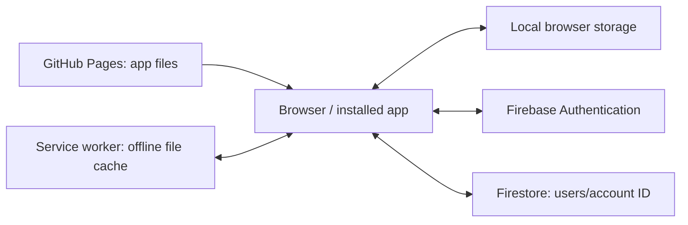

# Bharathi’s Study Tracker — code and user guide

This guide explains the current study app in plain language, with technical details for maintaining it. It describes the implementation rather than promising capabilities beyond the code.

- Repository: https://github.com/Bharathibanu/study-app
- Website: https://bharathibanu.github.io/study-app/
- Firebase project: `studyapp-tracker`
- Platform: static browser app, installable as a Progressive Web App (PWA).

## Contents

1. Architecture and vocabulary
2. Repository files
3. Every screen and feature
4. Plan, achievement and gap calculations
5. JavaScript structure and events
6. Data model
7. Login, Firebase and privacy
8. Offline operation and sync limitations
9. Backups and recovery
10. Installation and updates
11. Design and accessibility
12. Local development and verification
13. Troubleshooting
14. Function and action reference

## 1. Architecture and vocabulary

The browser downloads HTML, CSS and JavaScript from GitHub Pages. JavaScript runs on your device, reads local records, and talks to Firebase when signed in. There is no custom application server, npm build pipeline or Android APK in this repository.



| Term | Meaning here |
|---|---|
| Repository | The folder and history of app source files on GitHub |
| Branch `main` | The version GitHub Pages publishes |
| Commit | A saved set of code changes with a unique ID |
| Deployment | Publishing repository files to the website |
| HTML | Screen structure |
| CSS | Colours, sizes, spacing, responsive layout and animations |
| JavaScript | Behaviour, calculations and saving |
| JSON | Structured text representing your records |
| CSV | Rows of timetable data separated by commas |
| UID | Firebase’s unique account identifier, distinct from your email |
| PWA | A website installed with its own icon and window |
| Service worker | Browser-managed code that caches app files |

## 2. Repository files

### `index.html`: the app shell

Defines the login form, welcome animation, app container, sidebar, page content area, shared modal and toast. Loads the stylesheet and `app.js` as a JavaScript module. Links the manifest, icons and Google Fonts.

Important elements: `#login`, `#lform`, `#user`, `#pass`, `#welcome`, `#app`, `#side`, `#view`, `#modal`, `#mform`, `#toast`. JavaScript finds these by ID and changes their contents or visibility.

`hidden` determines whether a screen is displayed. The CSS `[hidden] { display: none !important; }` rule is necessary because layout rules such as `display:flex` would otherwise override the browser’s hiding behaviour.

### `styles.css`: the design

Defines colour variables, fonts, light/dark mode, forms, cards, charts, tables, modal layout, mobile navigation, print styles and motion. The calm teal-and-gold additions use restrained shadows, gold borders, gradient progress bars and short interaction animations. Reduced-motion rules disable animation and transitions.

Changing a colour variable affects many components. Semantic error colours remain separate from decorative gold.

### `app.js`: the application

Contains the data model, local persistence, Firebase integration calls, date utilities, view rendering, study tracking, revision quizzes, timetable import, expense calculations, reminders and event handlers. Most application behaviour lives here.

### `cloud.js`: the Firebase adapter

Imports public Firebase configuration. Dynamically loads Firebase SDK version `10.12.2` from Google’s CDN only when configuration is enabled. Initializes Authentication and Firestore, attempts persistent Firestore caching, exposes account operations, watches the account document and saves the state as JSON.

### `firebase-config.js`: project identification

Exports `apiKey`, `authDomain`, `projectId` and `appId`. These identify the web application; they are not the user’s password or a service-account credential. Database protection comes from Authentication and Firestore rules. Analytics and Storage are not initialized by this app even if the Firebase console’s example includes their configuration.

### `my-timetable.csv`: your timetable

Contains 542 original topic groups for Days 1–190, extracted from the uploaded PDF. The cover says 200 days, but Days 191–200 are absent. Topic numbers are lesson identifiers, not durations. Original groups use an estimated hour because the PDF provides no durations.

Columns: `Day,Date,Subject,Topic,Planned Hours,Notes`. Blank dates are filled using the chosen Day 1 date. Quoted CSV values preserve commas inside topics. The current importer does not save the Notes column into plan rows.

### `sw.js`: offline files and update cache

Caches the app shell, code, stylesheet, configuration, manifest, timetable and icons. On installation it fills the cache and requests activation. On activation it deletes older named caches and claims clients. For matching GET requests it returns a cached response when available while attempting a network refresh. Authentication and database traffic are not replaced with cached HTML responses.

Increasing the cache version accompanies app-file changes. This updates cached assets; it does not erase localStorage or Firebase records.

### `manifest.json`: installation metadata

Defines the full name, short name, description, launch URL, scope, standalone display, theme/background colours and icon sizes. The maskable icon has padding for Android launcher cropping. Installed-icon refresh timing is controlled partly by the browser and phone.

### `icons/`

Current `logo-192.png`, `logo-512.png` and `logo-maskable-512.png` provide the golden artwork for browser and installed icons. Older icon files may remain in the repository but are not the current manifest references.

### `README.md` and this guide

The README contains the original setup and usage instructions; some wording predates later additions. This guide documents the expanded implementation. Neither file is a database backup.

## 3. Every screen and feature

### Login and account creation

Firebase mode uses name, email and password for registration, then email/password for sign-in. Remember me chooses persistent versus session authentication. Password hashing and verification are handled by Firebase in this mode. A legacy local-only mode exists when Firebase configuration contains placeholders; that mode stores a salted hash in browser storage and does not synchronize accounts.

Creating a Firebase account does not automatically migrate the previous local-only state. Import a backup after signing in if migration is needed.

### Home

Shows the greeting, date, streak, daily task percentage, study minutes, expenses, critical items, today’s schedule, meetings, compact to-dos, level and badges. The shared plan-tracking panel shows achievement against imported plan rows.

Task checkbox: records the remaining planned minutes as manually completed. **Part** / **Log progress**: records a chosen number of minutes. Delete removes the task and linked study logs. Reschedule moves an unfinished task’s working date; its original due date still matters for overdue accounting.

### Study Timer

Focus and break periods use configured minute lengths. Start/pause controls interval updates. Stop and save opens a session form; elapsed time is not automatically durable just because the timer ran. The form records subject, topic, minutes and focus rating.

Choose a plan topic in the session form to credit its achievement. Extra study remains a session but does not reduce a plan topic’s gap. Credited minutes are capped at the task’s remaining planned duration. Deleting a linked session subtracts its credited minutes and can reopen the task.

### Trendline

Uses study logs to show a recent-hours chart, averages, week-to-week direction, focused-day comparisons and a heatmap. Comparisons use the general daily target. The shared plan panel separately reports imported-plan achievement. A trend of total study hours is not the same as finishing assigned plan topics.

### Quick Revision

Offers generated short arithmetic drills, learning examples, practice, multiple-choice options and flashcards. Quiz state tracks answers, score and timing. Finished drills enter the quick-revision history; incorrect answers can become mistakes to revisit. These drills do not automatically complete SSC timetable lessons.

### Revision Log

Records topic, subject, date, minutes, question count and correct answers. Due revisions use offsets of 1, 3, 7, 15 and 30 days from the first matching study date, advancing based on logged revisions. Weak topics are below 60% accuracy over at least 10 questions. This is a simple schedule based on counts, not an adaptive memory model.

### Reports

Day reports show timetable rows, planned time, achieved task minutes, statuses and carry-forward work. Week/month reports summarize study logs, tasks and expenditure. Printing uses browser print styles and can save a PDF. The shared plan panel is cumulative to today, even when a historical report date is selected; read its “to date” labels separately from the selected-period report.

### SSC Plan

Load the supplied timetable, upload CSV or paste CSV text. Choose Day 1 when dates are absent. Skip-past mode excludes earlier rows from generated overdue work and the cumulative gap. Import replaces the plan; it is not an append operation.

**Separate numbered lessons** splits a loaded group such as `Number Series 1,2,3` into individual tasks. New imports also split automatically. Existing recorded minutes are allocated in lesson order, not inferred as evidence that a specific numbered lesson was actually studied.

**Skip today** shifts future plan dates by a day. **Remove plan** clears plan rows and removes untouched generated tasks, retaining completed/partially studied history. Export a backup before restructuring an active plan.

### To-Do

Separate from study tasks. Cards have title, note, priority, due date, reminder and completion date. Open/done/all filters and waiting/overdue statistics help manage general work. Finishing a to-do does not award minutes to a timetable topic.

### Learning

Tracks books, total pages and dated page logs. Progress and pace estimates use logged pages. Learning cards contain what you learned, tags and optional book links. Pages and learning notes are not automatically converted into timetable achievement minutes.

### Diary

Stores dated entries, optional title, mood and starred status. Search and important-only filtering help retrieve entries. Diary text is included in the same account state and backup as study records.

### DHANAM Canteen

Tracks morning tea, afternoon tea, snacks and lunch quantities. Quantity multiplied by price yields the daily cost. Monthly tables/charts summarize spending, which contributes to money totals. Day records can retain price snapshots. Changing prices updates defaults and the selected existing day record; inspect earlier day records before assuming every historical price is unchanged.

### Money & Meetings

Expenses have amount, category, payment mode, date and note. Meetings have title, date, time, participant information, notes and completion status. Budget views include canteen spending. These are manual records, not bank connections or calendar integrations.

### Mock Tests

Records test name, date, score, maximum marks, time and notes. Displays performance history and calculations from entered results. Mock scores remain distinct from plan completion.

### Notes & Formulas

Provides built-in study reference material, search and personal notes/tags. Built-in arrays live in source code; personal notes live in account state. Notes are not executable code.

### Multiplication Tricks

Contains explanations/examples, practice quizzes and a mastered toggle for each trick. Mastery is manually recorded rather than independently assessed certification.

### Settings

Daily target, exam date, focus/break minutes, motivation, budget, name, theme and notifications. Field-change handlers save values; theme preference is device-local. Data controls export/import backups, add/remove demo records and erase the active account state.

**Erase everything** requires a second click but still overwrites active data. Demo data is marked so it can be removed separately. Importing a backup replaces state rather than merging every item.

### More and Quick add

Phone navigation presents a smaller primary menu; More opens secondary sections. The floating plus button opens commonly used add forms. Desktop navigation lists more sections directly.

## 4. Plan, achievement and gap calculations

`genPlan()` creates tasks for due plan rows, using a key built from date, subject and topic to avoid generating the same row repeatedly. Future rows stay in the plan until due.

`rollover()` changes an unfinished task’s working date to today but preserves `orig`, its original date. More than three days of carry creates a critical item. Missing yesterday’s quick revision creates a warning; two or more missed days can enter the critical zone.

For plan-tracking rows due through today:

```text
Achieved per row = min(planned minutes, max(0, matching task.spent))
Gap per row      = max(0, planned minutes - achieved)
Total gap        = sum(gaps of eligible rows due through today)
Achievement %    = achieved minutes / planned minutes × 100
```

Future rows and rows excluded by skip-past mode are not counted as overdue. Extra sessions, to-dos and quiz scores are not silently credited to plan rows.

Example: a 60-minute `Number Series 1,2,3` group becomes three 20-minute tasks. Logging 10 minutes against Number Series 1 leaves 10 minutes on that lesson and 50 minutes across the original group. A 60-minute group with four lessons becomes four 15-minute tasks. Whole-minute division distributes rounding remainders so the total duration is preserved.

Some old dashboard/report statistics count all study logs or all tasks, including manual additions. The imported-plan panel uses only matching plan tasks. Read the labels rather than assuming these are identical measures.

### Streaks, XP and badges

Streaks count consecutive dates with study logs. Today may be unfinished without breaking a streak that ends yesterday. Best streak is computed from sorted unique log dates.

XP = floor(total study minutes / 6) + 10 × completed tasks + 5 × revision drills + 20 × perfect drills + 15 × mock tests. Level uses a square-root progression. Badges cover a 7-day streak, 100 hours, a perfect drill, 5 mocks, 30 tasks and 10 revision drills. Manual completion can contribute study logs and XP.

## 5. JavaScript structure and events

Helpers format dates, currency and hours, select DOM elements, escape HTML, and safely attempt local/session storage operations. `esc()` is used when interpolating user text into HTML; future features must keep using appropriate escaping.

`NAV` and `TITLES` describe navigation. `VIEWS` maps page names to functions returning HTML. `show()` chooses a page; `render()` replaces the page content and invokes a page-specific `AFTER` callback. Charts are SVG strings generated by chart helpers rather than external chart packages.

`ACT` handles button actions; `CHG` handles changes such as checkbox and setting updates; `INP` handles live typing. Delegated listeners inspect `data-act`, `data-chg` and `data-inp`. A button such as `data-act="addStudy"` invokes the corresponding handler without individual inline JavaScript.

`openForm()` builds the shared modal from field definitions and stores its submission callback. `openMenu()` reuses the modal for action choices. `toast()` gives brief feedback. `confetti()` respects reduced-motion preferences.

Timer state (`T`), quiz state (`QZ`), filters and the current view are runtime variables. They are not all included in durable saved state.

## 6. Data model

`S` is the active account state. `blank()` provides default values; `loadLocal()` merges stored values into defaults.

| Field | Contents |
|---|---|
| `v`, `_u`, `created`, `name` | Schema version, last-change milliseconds, creation date and display name |
| `settings` | Target, budget, exam, focus/break lengths, motivation and Day 1 |
| `plan`, `planFrom` | Imported schedule and skip-past cutoff |
| `tasks` | Generated/manual study tasks and recorded achievement |
| `logs` | Study sessions and automatic completion logs |
| `rev`, `qr`, `mist` | Revision records, quick-drill history and mistakes |
| `mocks` | Mock test results |
| `exp`, `meet` | Expenses and meetings |
| `notes`, `mastered` | Personal notes and trick-mastery flags |
| `canteen` | Prices and per-day quantity/price records |
| `todos` | General to-do cards |
| `books`, `learn`, `diary` | Reading records, learning cards and diary entries |

A task uses `id`, `pk` for generated-plan identity, `orig`, `date`, `subj`, `topic`, `plan`, `spent`, `done`, `doneDate`. A study log uses date, timestamp, subject, topic, minutes, focus and optional linked task/credit. Some logs have `auto:true` for checkbox-generated completion.

Local-only state uses `sst_state_local`; Firebase accounts use `sst_state_<UID>`. `sst_theme` stores device theme. Legacy credentials and remember/session flags use separate keys. Browser storage is not a secure encrypted vault.

## 7. Login, Firebase and privacy

Authentication manages email/password accounts and sessions. The app does not store the raw Firebase password in its study JSON. Never put service-account credentials, private keys or a personal password in GitHub.

The configured public website domain is `bharathibanu.github.io`. Firestore documents use:

```text
users/<Firebase UID>
  data: string containing JSON.stringify(S)
  updated: S._u
```

The app uses one document for the whole account, not a collection per feature. `data` is a string, so the Firebase console displays a long JSON value rather than friendly separate task rows. `updated` is a client-side millisecond value, not a server-authored audit timestamp.

Owner-only rules:

```text
rules_version = '2';
service cloud.firestore {
  match /databases/{database}/documents {
    match /users/{userId} {
      allow read, write: if request.auth != null
                        && request.auth.uid == userId;
    }
  }
}
```

These restrict app-client access to each account’s document. Firebase project administrators can access records using their administrative permissions. The rules do not provide per-field validation. GitHub code and icons are public; personal records are not stored in the repository by the app.

The app requests notifications if you choose reminders. It does not include integrations to read contacts, photos, messages or bank transactions. A backup file itself contains personal records, so protect it.

## 8. Offline operation and sync limitations

There are three separate storage layers: cached app files, browser localStorage state and Firestore’s persistent cache where supported. A previously loaded and authenticated device can often continue offline, but new sign-in requires network access and missing SDK/assets may prevent offline startup. Not every offline scenario has been verified.

`persist()` updates `_u`, saves local JSON and debounces a cloud save by approximately 700 ms. Successful cloud write promises update the sync label. `onRemote()` compares client timestamps and replaces state with a newer remote snapshot, or attempts to send newer local state.

Important current limitations:

- The whole state is replaced as one document; concurrent edits can overwrite each other.
- Client clock differences can affect “newer” comparisons.
- A cached snapshot can cause “Synced” to appear without proving a fresh server acknowledgement.
- Some save errors are caught without detailed user diagnostics.
- Firestore documents have a roughly 1 MiB size limit; very large diaries/log histories can outgrow this design.
- Clearing local storage before a successful sync can lose pending changes.

Use one device at a time when offline, reconnect and verify changes on another device, and retain backups. Do not describe the existing implementation as conflict-free or a guaranteed delivery system.

## 9. Backups and recovery

Export creates a dated JSON download containing active state. Import reads JSON, requires an object with a `logs` array, fills defaults and replaces the active state. Validation is basic; import only trusted app backups.

Before large imports, splitting lessons or deleting data, export a copy. For local-to-Firebase migration, export before enabling cloud login, sign into the account, then import the backup. Verify its records and a cross-device test.

If downloads fail on a device, check the browser’s download location/permissions or export from the computer. Do not paste diary or full backup contents into public GitHub issues.

## 10. Installation and updates

Android Chrome: open the website, sign in, choose Install app if available. Add to Home screen may create a shortcut instead of a full installed web app. Both open the same website but launcher presentation can differ.

For updates, wait for GitHub Pages deployment, connect to the internet, fully close the app, open it, close it and reopen. A cached response may be served during the first refresh. Updating icons can take longer than updating page content. Do not clear storage merely to force an icon change.

Maintainers commit changes to `main`. GitHub Actions/Pages publishes the site. For app-file changes, increase `CACHE` in `sw.js` and include new required files in its asset list. A documentation-only change does not require a cache-version change.

## 11. Design and accessibility

CSS custom properties define teal, gold, surfaces, text, borders and status colours. Light and dark modes adjust them; the selected theme is stored on each device. Navigation and cards adapt to smaller widths. Secondary phone pages appear under More.

Controls include labels and many accessible names. Use visible keyboard focus, adequate contrast and reduced-motion rules when adding features. Do not convey warnings only through colour: retain text such as Overdue or Critical. Existing print rules hide controls and adapt reports.

## 12. Local development and verification

Use the existing checkout. No dependency install or build is needed for the static app.

```bash
cd /workspace/study-app
python3 -m http.server 8000 --bind 127.0.0.1
```

Open the served page in a development browser. Serving over HTTP is needed for modules and avoids file-URL restrictions. Localhost is suitable for internal checks; onboarding does not provide a public localhost preview link.

```bash
node --input-type=module --check < app.js
node --input-type=module --check < cloud.js
node --input-type=module --check < firebase-config.js
node --check sw.js
git diff --check
```

Syntax checks do not prove behaviour. Also test login, a real task save/reload, linked session credit and deletion, lesson splitting, mobile layout and reduced motion. Test Firebase with an account you control rather than committing passwords. Cross-device creation and deletion provide useful evidence of real cloud delivery.

## 13. Troubleshooting

| Symptom | Check |
|---|---|
| Empty popup blocks login | Ensure the `[hidden]` CSS rule is present and current assets loaded |
| Email looks like a narrow default input | Email must be included in the styled input selectors |
| Invalid API key | Compare copied configuration text exactly; screenshots can confuse `1` and `l` |
| Permission denied when saving | Check sign-in UID, database selection and owner-only rules |
| Old topic groups still appear | SSC Plan → Separate numbered lessons; verify new code is loaded |
| Missing newly added buttons | Check Pages deployment and refresh cached app files |
| No study data in Analytics | Open Firestore → Data → users; Analytics is a different product |
| Records absent after cloud signup | Import the old account backup; cloud/local keys are different |
| Installation stuck | Update Chrome, check storage/network and phone installation settings; use the browser while troubleshooting |
| Tiny shortcut icon | Launcher badge/mask/padding can shrink the artwork; check installed-app versus shortcut behaviour |
| Reminder absent when app is closed | Current reminder checks run while the app is active; there is no scheduled background push service |
| Conflicting records across devices | Avoid simultaneous offline edits; export both copies before attempting recovery |

## 14. Function and action reference

The following inventory links current functions to source lines and groups buttons/field handlers. Line numbers are a snapshot and can shift with later edits. Small utility arrows and constants are described in the relevant sections above rather than every literal icon/path.


### Named functions and page renderers

| Name | Source |
|---|---|
| `rng` | [app.js line 32](../app.js#L32) |
| `loadLocal` | [app.js line 94](../app.js#L94) |
| `setSync` | [app.js line 101](../app.js#L101) |
| `persist` | [app.js line 102](../app.js#L102) |
| `onRemote` | [app.js line 113](../app.js#L113) |
| `dataChanged` | [app.js line 124](../app.js#L124) |
| `genPlan` | [app.js line 127](../app.js#L127) |
| `planTracking` | [app.js line 141](../app.js#L141) |
| `rollover` | [app.js line 163](../app.js#L163) |
| `todayTasks` | [app.js line 169](../app.js#L169) |
| `critItems` | [app.js line 174](../app.js#L174) |
| `qrMissed` | [app.js line 180](../app.js#L180) |
| `streak` | [app.js line 194](../app.js#L194) |
| `bestStreak` | [app.js line 198](../app.js#L198) |
| `gamify` | [app.js line 203](../app.js#L203) |
| `setTaskDone` | [app.js line 214](../app.js#L214) |
| `toast` | [app.js line 230](../app.js#L230) |
| `confetti` | [app.js line 234](../app.js#L234) |
| `openForm` | [app.js line 246](../app.js#L246) |
| `openMenu` | [app.js line 265](../app.js#L265) |
| `lineSVG` | [app.js line 292](../app.js#L292) |
| `barsSVG` | [app.js line 309](../app.js#L309) |
| `donutSVG` | [app.js line 319](../app.js#L319) |
| `buildNav` | [app.js line 328](../app.js#L328) |
| `show` | [app.js line 336](../app.js#L336) |
| `render` | [app.js line 339](../app.js#L339) |
| `VIEWS.home` | [app.js line 365](../app.js#L365) |
| `tReset` | [app.js line 426](../app.js#L426) |
| `tTick` | [app.js line 427](../app.js#L427) |
| `tPaint` | [app.js line 437](../app.js#L437) |
| `beep` | [app.js line 442](../app.js#L442) |
| `saveSession` | [app.js line 445](../app.js#L445) |
| `VIEWS.study` | [app.js line 457](../app.js#L457) |
| `VIEWS.trend` | [app.js line 471](../app.js#L471) |
| `gen` | [app.js line 520](../app.js#L520) |
| `mcqOpts` | [app.js line 545](../app.js#L545) |
| `quizStart` | [app.js line 550](../app.js#L550) |
| `quizDraw` | [app.js line 556](../app.js#L556) |
| `quizCheck` | [app.js line 577](../app.js#L577) |
| `quizNext` | [app.js line 586](../app.js#L586) |
| `finishDrill` | [app.js line 587](../app.js#L587) |
| `revPanel` | [app.js line 594](../app.js#L594) |
| `flashDraw` | [app.js line 609](../app.js#L609) |
| `VIEWS.rev` | [app.js line 613](../app.js#L613) |
| `flashNew` | [app.js line 621](../app.js#L621) |
| `dueRevisions` | [app.js line 625](../app.js#L625) |
| `VIEWS.revlog` | [app.js line 635](../app.js#L635) |
| `dayRows` | [app.js line 649](../app.js#L649) |
| `VIEWS.rep` | [app.js line 661](../app.js#L661) |
| `parseDateStr` | [app.js line 681](../app.js#L681) |
| `splitLine` | [app.js line 687](../app.js#L687) |
| `lessonTopics` | [app.js line 692](../app.js#L692) |
| `splitPlanLessons` | [app.js line 700](../app.js#L700) |
| `importPlan` | [app.js line 737](../app.js#L737) |
| `VIEWS.plan` | [app.js line 751](../app.js#L751) |
| `VIEWS.tricks` | [app.js line 792](../app.js#L792) |
| `runTrick` | [app.js line 800](../app.js#L800) |
| `VIEWS.money` | [app.js line 817](../app.js#L817) |
| `VIEWS.mocks` | [app.js line 829](../app.js#L829) |
| `VIEWS.notes` | [app.js line 858](../app.js#L858) |
| `cMonthHTML` | [app.js line 869](../app.js#L869) |
| `VIEWS.canteen` | [app.js line 881](../app.js#L881) |
| `setC` | [app.js line 894](../app.js#L894) |
| `refreshCanteen` | [app.js line 899](../app.js#L899) |
| `todoSort` | [app.js line 907](../app.js#L907) |
| `ageText` | [app.js line 908](../app.js#L908) |
| `gapText` | [app.js line 909](../app.js#L909) |
| `fmtDT` | [app.js line 921](../app.js#L921) |
| `remBanner` | [app.js line 922](../app.js#L922) |
| `todoCompact` | [app.js line 927](../app.js#L927) |
| `VIEWS.todo` | [app.js line 932](../app.js#L932) |
| `VIEWS.learn` | [app.js line 953](../app.js#L953) |
| `VIEWS.diary` | [app.js line 976](../app.js#L976) |
| `VIEWS.set` | [app.js line 990](../app.js#L990) |
| `loadDemo` | [app.js line 1002](../app.js#L1002) |
| `clearDemo` | [app.js line 1036](../app.js#L1036) |
| `notify` | [app.js line 1044](../app.js#L1044) |
| `download` | [app.js line 1051](../app.js#L1051) |
| `applyTheme` | [app.js line 1055](../app.js#L1055) |
| `sure` | [app.js line 1149](../app.js#L1149) |
| `todoForm` | [app.js line 1153](../app.js#L1153) |
| `bookForm` | [app.js line 1166](../app.js#L1166) |
| `learnForm` | [app.js line 1178](../app.js#L1178) |
| `diaryForm` | [app.js line 1190](../app.js#L1190) |
| `checkReminders` | [app.js line 1242](../app.js#L1242) |
| `startReminders` | [app.js line 1248](../app.js#L1248) |
| `VIEWS.more` | [app.js line 1257](../app.js#L1257) |
| `hashPw` | [app.js line 1262](../app.js#L1262) |
| `loginMode` | [app.js line 1267](../app.js#L1267) |
| `loginErr` | [app.js line 1279](../app.js#L1279) |
| `startSession` | [app.js line 1304](../app.js#L1304) |
| `runWelcome` | [app.js line 1312](../app.js#L1312) |
| `enterApp` | [app.js line 1325](../app.js#L1325) |
| `remind` | [app.js line 1328](../app.js#L1328) |
| `logout` | [app.js line 1332](../app.js#L1332) |
| `boot` | [app.js line 1337](../app.js#L1337) |

### Event handler index


#### ACT

- `nav` — [implementation](../app.js#L1057).
- `theme` — [implementation](../app.js#L1058).
- `logout` — [implementation](../app.js#L1059).
- `closeModal` — [implementation](../app.js#L1060).
- `fab` — [implementation](../app.js#L1061).
- `addTask` — [implementation](../app.js#L1062).
- `addStudy` — [implementation](../app.js#L1063).
- `addExp` — [implementation](../app.js#L1064).
- `addMeet` — [implementation](../app.js#L1065).
- `addNote` — [implementation](../app.js#L1066).
- `addRev` — [implementation](../app.js#L1067).
- `addMock` — [implementation](../app.js#L1068).
- `partial` — [implementation](../app.js#L1069).
- `delTask` — [implementation](../app.js#L1070).
- `doneTask` — [implementation](../app.js#L1071).
- `resched` — [implementation](../app.js#L1072).
- `delLog` — [implementation](../app.js#L1073).
- `delExp` — [implementation](../app.js#L1074).
- `delMeet` — [implementation](../app.js#L1075).
- `toggleMeet` — [implementation](../app.js#L1076).
- `delRev` — [implementation](../app.js#L1077).
- `delMock` — [implementation](../app.js#L1078).
- `delNote` — [implementation](../app.js#L1079).
- `delMist` — [implementation](../app.js#L1080).
- `tToggle` — [implementation](../app.js#L1081).
- `tResetBtn` — [implementation](../app.js#L1082).
- `tSave` — [implementation](../app.js#L1083).
- `revKind` — [implementation](../app.js#L1084).
- `revMode` — [implementation](../app.js#L1085).
- `qzStartRev` — [implementation](../app.js#L1086).
- `qzCheck` — [implementation](../app.js#L1087).
- `qzAns` — [implementation](../app.js#L1088).
- `qzNext` — [implementation](../app.js#L1089).
- `qzAgain` — [implementation](../app.js#L1090).
- `flip` — [implementation](../app.js#L1091).
- `flashNext` — [implementation](../app.js#L1092).
- `repMode` — [implementation](../app.js#L1093).
- `repDate` — [implementation](../app.js#L1094).
- `print` — [implementation](../app.js#L1095).
- `splitLessons` — [implementation](../app.js#L1096).
- `loadTimetable` — [implementation](../app.js#L1097).
- `planPaste` — [implementation](../app.js#L1115).
- `sampleCsv` — [implementation](../app.js#L1120).
- `skipToday` — [implementation](../app.js#L1121).
- `clearPlan` — [implementation](../app.js#L1122).
- `runTrick` — [implementation](../app.js#L1123).
- `trickQuiz` — [implementation](../app.js#L1124).
- `mastered` — [implementation](../app.js#L1125).
- `exportData` — [implementation](../app.js#L1126).
- `loadDemo` — [implementation](../app.js#L1127).
- `clearDemo` — [implementation](../app.js#L1128).
- `resetAll` — [implementation](../app.js#L1129).
- `notif` — [implementation](../app.js#L1130).

#### CHG

- `toggleTask` — [implementation](../app.js#L1133).
- `tField` — [implementation](../app.js#L1134).
- `mcq` — [implementation](../app.js#L1135).
- `revFilter` — [implementation](../app.js#L1136).
- `formulaQ` — [implementation](../app.js#L1137).
- `setting` — [implementation](../app.js#L1138).
- `nameSet` — [implementation](../app.js#L1139).
- `planFile` — [implementation](../app.js#L1140).
- `importData` — [implementation](../app.js#L1141).

#### INP

- `canteen` — [implementation](../app.js#L1235).
- `search` — [implementation](../app.js#L1236).

### Firebase adapter functions

- `init` — [cloud.js line 13](../cloud.js#L13).
- `onUser` — [cloud.js line 31](../cloud.js#L31).
- `signIn` — [cloud.js line 37](../cloud.js#L37).
- `signUp` — [cloud.js line 42](../cloud.js#L42).
- `signOut` — [cloud.js line 47](../cloud.js#L47).
- `subscribe` — [cloud.js line 49](../cloud.js#L49).
- `save` — [cloud.js line 57](../cloud.js#L57).

## Maintenance priorities for future work

Improve server-acknowledged sync status, conflict handling, document size management, schema validation, accessible controls and testing before relying on larger multi-device workloads. A native APK is optional; it is not required for current study tracking and would not automatically fix database design.
